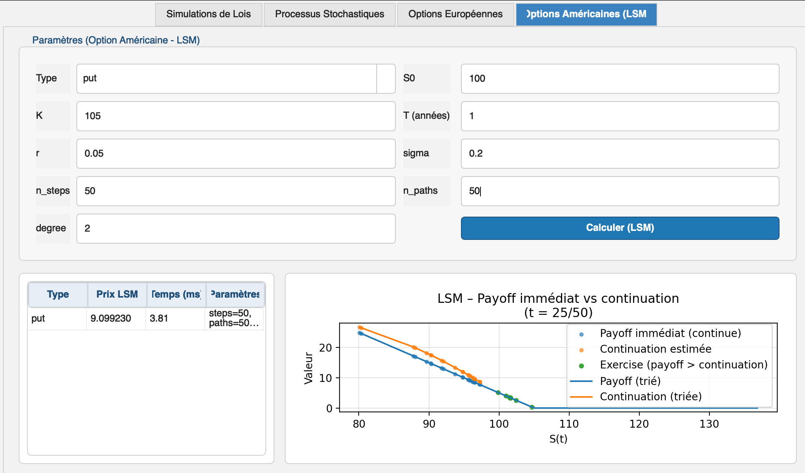

# Valorisation d'options par Monte-Carlo et Longstaff-Schwartz

Projet réalisé par **Reda Erraoui** — ENSA Agadir, filière Finance et Ingénierie Décisionnelle, sous l'encadrement de Pr. B. El Asri.

**[Essayer le simulateur en ligne](https://redaerraoui.github.io/simulateurs/monte-carlo-lsm.html)** · **[Lire le rapport (PDF)](rapport.pdf)**

## Contenu

1. **Génération de lois** : loi uniforme, loi exponentielle par inversion, loi normale par Box-Muller.
2. **Processus stochastiques** : mouvement brownien, mouvement brownien géométrique, schéma d'Euler.
3. **Options européennes par Monte-Carlo** : estimateur, intervalle de confiance, convergence en O(1/√N).
4. **Réduction de variance** : variables antithétiques et variable de contrôle (X = e^(−rT) S_T − S₀).
5. **Options américaines** : méthode de Longstaff-Schwartz (régression des valeurs de continuation sur les trajectoires dans la monnaie).

L'application PyQt5 (`MonteCarloApp`) regroupe ces quatre volets dans des onglets interactifs.

## Résultats

**Validation de Longstaff-Schwartz** — put américain, K = 40, r = 6 %, σ = 20 %, T = 1 an, 50 dates d'exercice, régression de degré 2 :

| S₀ | LSM (100 000 trajectoires) | Article de Longstaff et Schwartz (2001) |
|---:|---:|---:|
| 36 | 4,46 | 4,478 |
| 40 | 2,31 | 2,314 |
| 44 | 1,10 | 1,110 |

Les écarts, de l'ordre de 0,01, semblent cohérents avec l'erreur de Monte-Carlo et le léger biais bas de LSM.

**Réduction de variance** — call européen ATM (S₀ = K = 100, r = 5 %, σ = 20 %, T = 1), à nombre de simulations égal : les variables antithétiques divisent la variance de l'estimateur par environ 2, la variable de contrôle par environ 6,8 (100 000 simulations).



## Lancement

```bash
pip install -r requirements.txt
python -m MonteCarloApp.main
```

## Corrections apportées (octobre 2026)

- **Variables antithétiques** : les tirages Z et −Z ne sont pas indépendants. La variance de l'estimateur est désormais calculée sur les moyennes de paires ; l'ancien calcul donnait un ratio de variance proche de 1, comme si la méthode n'apportait rien (`core/options.py`, `gui/tab_methods.py`).
- **Variable de contrôle** : `european_option_mc_report` accepte maintenant `method="control_variate"`, utilisé par `payoff_distributions_european` qui levait une erreur.
- **Reproductibilité** : `gbm_paths` accepte une graine aléatoire.

## Contact

Reda Erraoui · [Portfolio](https://redaerraoui.github.io) · redaerraouie@gmail.com
